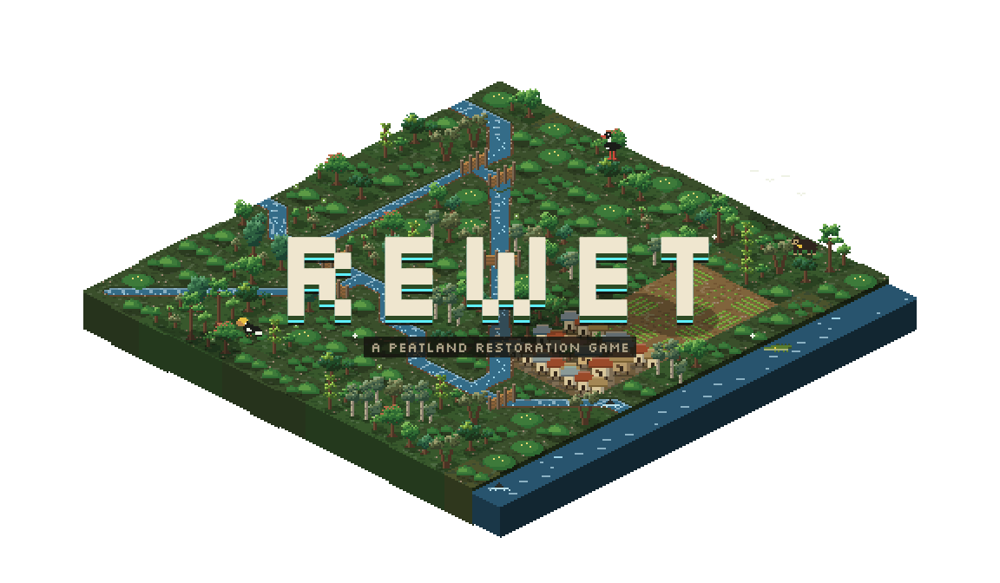
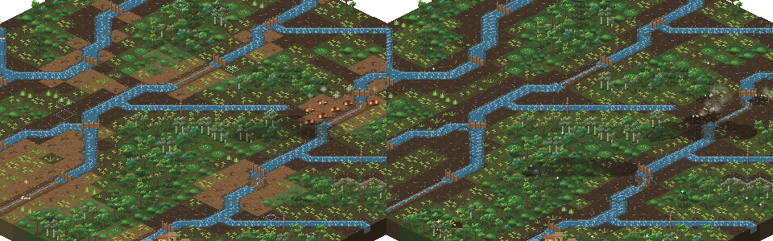
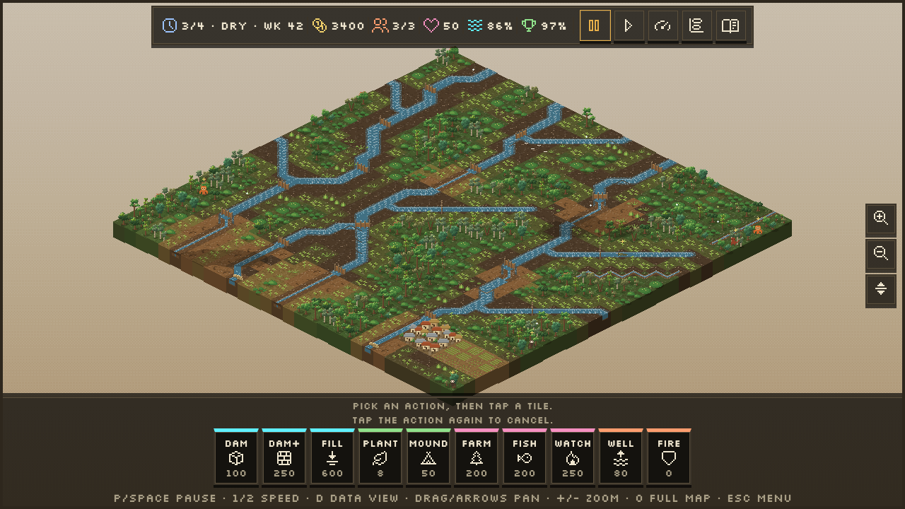
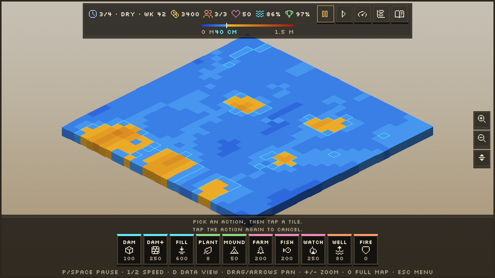
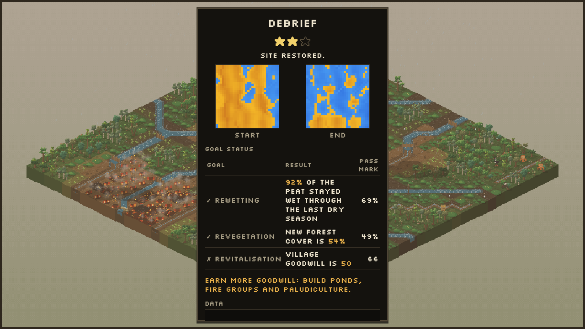
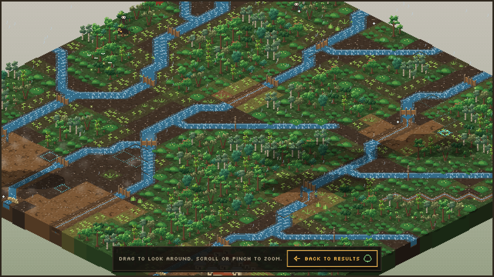

<p align="center">
  
</p>

<p align="center">
  <b>The peat is drying out. The fire season is coming. You have four years.</b><br>
  A pixel-art strategy game about saving a tropical peat swamp in Indonesia.
</p>

<p align="center">
  <a href="https://hexaconservation-rewet.netlify.app/"><b>▶ Play in your browser</b></a>
  &nbsp;·&nbsp; free &nbsp;·&nbsp; no install &nbsp;·&nbsp; desktop and phone &nbsp;·&nbsp; English and Bahasa Indonesia
</p>

<p align="center">
  <br>
  <sub><b>Left:</b> the wet season arrives, dry to wet. &nbsp; <b>Right:</b> the dry season arrives, wet to dry.</sub>
</p>

## Put the water back

Old drainage canals cut through the swamp. They pull the water out of the peat, most strongly near the canal.[^R14-t4] Drained peat sinks,[^R14-p2] loses its carbon to the air[^IPCC13-t21] and burns more easily once the water table falls below 0.40 m.[^R14-p2]

You lead a small restoration team. Your tools follow real practice:

- **Block** the canals with dams, one after the other, from low to high ground.[^R14-p11]
- **Rewet** the peat until the water table stays within 40 cm of the surface, also in the dry season.[^PP57]
- **Replant** burnt land, and put seedlings on mounds where the ground floods.
- **Revitalise** the village with fish ponds, fire groups[^PP57-fire] and wet-land farming (paludiculture),[^FAO16] so the people help you and not the fire.

These are Indonesia's "3Rs" of peat restoration: rewetting, revegetation and revitalisation of livelihoods.[^W20] Each level teaches one more part of the practice.

<p align="center">
  
  
</p>

Press <kbd>D</kbd> to see under the surface. Blue peat is wet. Orange peat is dry and can burn. The line at 40 cm is the line that counts.

## What makes it different

- **The water is simulated, not scripted.** Each canal pulls the water table down with distance, and each block pushes it back up. One block on a long canal is not enough. You must build a cascade.[^R14-p11]
- **The model is checked against field data.** Three calibration tests guard the model. The water table at 10 m, 100 m, 400 m and 1,000 m from a canal must match the field values.[^R14-t4] After the canals in that study were dammed, the water table rose from 1.12 m to 0.37 m below the surface, and the game must give the same result.[^R14-p10] A cascade of blocks must also beat a single block.
- **The seasons decide.** The wet season wets the peat for free. The dry season shows if your work holds: in the field, the water table fell below 0.40 m again in the dry season after the dams.[^R14-p8] Then the El Niño year arrives.
- **The carbon is counted with IPCC default factors.** See [How the game counts carbon](#how-the-game-counts-carbon).
- **Wildlife comes back.** Orangutans, gibbons, hornbills, otters and 7 more species return as the swamp heals. All 11 species live in the Sebangau peat swamp forest in Central Kalimantan.[^H18] Each one goes into your field journal, with 15 short pages on the science.
- **Every pixel is drawn in code.** The game has no image files and no sound files. The map art, the music and the rain are made in the browser as you play.

## How the game counts carbon

At the end of each level, the debrief shows two results in tonnes of CO2. The calculation is in `co2Estimate()` in [`src/sim/score.js`](src/sim/score.js).

| Step | Value | Source |
|---|---|---|
| Area of one map tile | 50 m × 50 m = 0.25 ha | Game scale |
| A tile counts as wet | water table 0.40 m or less below the surface | PP 57/2016, Article 23(3)(a)[^PP57] |
| CO2 from drained peat | 14 t CO2-C per ha per year (tropical cropland and fallow, drained) | IPCC 2013 Wetlands Supplement, Table 2.1, p.2.13[^IPCC13-t21] |
| CO2 from rewetted peat | 0 t CO2-C per ha per year (tropical, saturated) | IPCC 2013 Wetlands Supplement, Table 3.1, p.3.12[^IPCC13-t31] |
| Peat burnt in a fire | 353 t dry matter per ha (tropical wildfire, drained peat) | IPCC 2013 Wetlands Supplement, Table 2.6, p.2.40[^IPCC13-fire] |
| Carbon in burnt peat | 464 g CO2-C per kg dry matter | IPCC 2013 Wetlands Supplement, Table 2.7, p.2.41[^IPCC13-fire] |
| Carbon to CO2 | × 44/12 (ratio of molecular weights) | IPCC 2006 Guidelines, Vol 4, Section 2.2.3, p.2.11[^IPCC06] |

**Drainage emissions avoided.** For each tile that was dry at the start and is wet at the end:
14 t C/ha/yr × 0.25 ha × (years the tile was wet) × 44/12.
One tile that stays wet for one year avoids 14 × 0.25 × 44/12 ≈ 12.8 t CO2.

**Fire emissions.** For each tile that burnt:
353 t/ha × 0.464 × 0.25 ha × 44/12.
One burnt tile gives 40.95 t C, which is about 150.1 t CO2.

**Limits.** These are Tier 1 default factors. They cover CO2 only. Rewetting also raises methane (CH4) emissions compared with drained peat,[^IPCC13-ch4] and the game does not count CH4 or N2O. We did not check the IPCC 2019 Refinement for changed factors.

## Six sites, one swamp

| | Site | Years | You learn |
|---|---|---|---|
| 1 | Small drained plot | 3 | Blocks, the 40 cm line, distance from the canal |
| 2 | Burnt former forest | 3 | Planting, seedlings that drown in dips, mounds |
| 3 | Village edge | 4 | Goodwill, wet-land farming, arson |
| 4 | Canal network | 4 | Cascades, backfill, illegal canals |
| 5 | El Niño year | 4 | Wells, fire crews, smouldering fire |
| 6 | Full peat dome | 5 | All of it, with higher pass marks |

Finish all six to open the sandbox.

<p align="center">
  
  
</p>

At the end of each level, the debrief shows your start and end water maps, your three goals and the carbon result. Then you can walk around the swamp you saved. The fire stops, the rain falls and the animals stay.

## Press kit

| | |
|---|---|
| Title | Rewet |
| One line | A pixel-art game about peatland restoration in Indonesia. Block canals, rewet the peat, stop fires, replant and help the village. |
| Genre | Strategy, simulation, educational |
| Platform | Web browser, desktop and phone |
| Languages | English, Bahasa Indonesia |
| Version | 1.0 |
| Price | Free to play |
| Play | https://hexaconservation-rewet.netlify.app/ |

**Short description (45 words).** Rewet is a pixel-art strategy game about saving a tropical peat swamp. Block old drainage canals, keep the peat wet through the dry season, stop fires and replant the forest. A water model, checked against field research in Kalimantan, decides if your plan works.

**Images.** All images are in [`docs/press/`](docs/press/). The maps show at a whole zoom step, so each game pixel stays square.

| File | Size | Contents |
|---|---|---|
| `docs/press/hero.gif` | 1152×672 | The title on the animated menu map. Transparent background, loops. |
| `docs/press/seasons.gif` | 960×300 | The wet season arrives (left) and the dry season arrives (right). Transparent background, loops. |
| `docs/press/level.png` | 1280×720 | A level in progress |
| `docs/press/data.png` | 1280×720 | The data view of the water table |
| `docs/press/debrief.png` | 1280×720 | The debrief at the end of a level |
| `docs/press/scenic.png` | 1280×720 | A restored site after the level ends |
| `og.png` | 1200×630 | The title on the menu map, for link previews |

To make the images again, serve the game and run `node scripts/press-kit.js`. It needs Chrome, and ffmpeg for the GIFs. Run `node scripts/og-image.js` for `og.png`.

## The science

**The science in Rewet is simplified for education.** The game shows how canals, blocks, seasons and fire work together. It is not a planning tool: do not use its numbers for a real site.

What we simplified:

- The water model is a fast grid model, tuned until it matches the field values from one canal in Central Kalimantan.[^R14-t4] Real peat domes differ from site to site.
- One map tile is 50 m × 50 m. The game runs 4 ticks per week.
- The carbon result uses Tier 1 default factors and CO2 only. See [Limits](#how-the-game-counts-carbon).
- Game costs, crew times and seedling survival are game balance, not real-world values.

Every real-world number in the game has a source that we opened, with the page or table cited. The full records are in [`docs/references/`](docs/references/). A value without a source is marked `NOT SOURCED` and does not go into the game text.

### Sources

[^R14-t4]: Ritzema, H.P. et al. (2014). "Canal blocking strategies for hydrological restoration of degraded tropical peatlands in Central Kalimantan, Indonesia". *Catena* 114, 11–20. [doi:10.1016/j.catena.2013.10.009](https://doi.org/10.1016/j.catena.2013.10.009). Table 4, post-print p.25 ([post-print PDF](https://edepot.wur.nl/282926)).
[^R14-p2]: Ritzema et al. (2014), post-print p.2: subsidence is 0.1 × the water-table depth per year, and fire risk increases below 0.40 m. [Post-print PDF](https://edepot.wur.nl/282926).
[^R14-p8]: Ritzema et al. (2014), post-print p.8: in the dry season after the dams, the water tables fell to well below 0.40 m. [Post-print PDF](https://edepot.wur.nl/282926).
[^R14-p10]: Ritzema et al. (2014), post-print p.10: the average water table rose from 1.12 m to 0.37 m below the surface. [Post-print PDF](https://edepot.wur.nl/282926).
[^R14-p11]: Ritzema et al. (2014), post-print p.11: the head difference over a dam should stay under 0.5 m, so a cascade of dams is necessary. [Post-print PDF](https://edepot.wur.nl/282926).
[^PP57]: Government Regulation (Peraturan Pemerintah) No. 57/2016, Article 23(3)(a), p.11: peat is damaged when the water table is more than 0.4 m below the surface. [PDF](https://peraturan.go.id/files/pp57-2016bt.pdf).
[^PP57-fire]: PP 57/2016, Article 22A(4)(c), p.10: village fire groups (*masyarakat peduli api*). [PDF](https://peraturan.go.id/files/pp57-2016bt.pdf).
[^W20]: Ward, C. et al. (2020). "Wading through the swamp: what does tropical peatland restoration mean to national-level stakeholders in Indonesia?" *Restoration Ecology* 28(4), 817–827, p.818. [doi:10.1111/rec.13133](https://doi.org/10.1111/rec.13133) ([PDF](https://eprints.whiterose.ac.uk/157071/3/rec.13133.pdf)).
[^FAO16]: Ministry of Environment and Forestry of Indonesia and FAO (2016). "Workshop report: Peatland paludiculture", p.2. [PDF](https://update23.greifswaldmoor.de/files/dokumente/2016_05_Final%20workshop%20report-MOEF%20FAO%20peatland%20paludiculture%20workshop%20May%202016.pdf).
[^IPCC13-t21]: IPCC (2014). *2013 Supplement to the 2006 IPCC Guidelines for National Greenhouse Gas Inventories: Wetlands*. Table 2.1, p.2.13. [PDF](https://www.ipcc.ch/site/assets/uploads/2018/03/Wetlands_Supplement_Entire_Report.pdf).
[^IPCC13-t31]: IPCC 2013 Wetlands Supplement, Table 3.1, p.3.12. [PDF](https://www.ipcc.ch/site/assets/uploads/2018/03/Wetlands_Supplement_Entire_Report.pdf).
[^IPCC13-fire]: IPCC 2013 Wetlands Supplement, Table 2.6, p.2.40 and Table 2.7, p.2.41. [PDF](https://www.ipcc.ch/site/assets/uploads/2018/03/Wetlands_Supplement_Entire_Report.pdf).
[^IPCC13-ch4]: IPCC 2013 Wetlands Supplement, p.1.9: rewetting decreases CO2 emissions and increases CH4 emissions compared with the drained state. [PDF](https://www.ipcc.ch/site/assets/uploads/2018/03/Wetlands_Supplement_Entire_Report.pdf).
[^IPCC06]: IPCC (2006). *2006 IPCC Guidelines for National Greenhouse Gas Inventories*, Volume 4, Chapter 2, Section 2.2.3, p.2.11. [PDF](https://www.ipcc-nggip.iges.or.jp/public/2006gl/pdf/4_Volume4/V4_02_Ch2_Generic.pdf).
[^H18]: Husson, S.J. et al. (2018). "Biodiversity of the Sebangau tropical peat swamp forest, Indonesian Borneo". *Mires and Peat* 22, Article 05, 1–50, appendix tables. [doi:10.19189/MaP.2018.OMB.352](https://doi.org/10.19189/MaP.2018.OMB.352) ([PDF](https://mires-and-peat.scholasticahq.com/article/128947.pdf)).

## Develop locally

You need:

- Python 3, to serve the files.
- Node.js 20 or later, to run the tests.

The game has no build step and no npm dependencies.

### Run the game

1. Start a static server in the repo root:

   ```bash
   python3 -m http.server 8765
   ```

2. Open http://localhost:8765 in a browser.

Do not open `index.html` from `file://`. Browsers do not load ES modules from `file://`.

### Run the tests

```bash
npm test                                   # all tests
node --test test/hydro.test.js             # one test file
node --test --test-name-pattern="C1" test/hydro.calibration.test.js   # one test by name
```

### Run a level without a browser

```bash
node scripts/sim-run.js --level 1 --plan test/fixtures/l1-cascade.json
```

## Project layout

| Path | Contents |
|---|---|
| `index.html` | Page layout and CSS |
| `src/sim/` | Simulation. Pure and deterministic, with no DOM access, so it runs under `node --test`. |
| `src/render/` | Canvas rendering. It only reads the game state. |
| `src/ui.js`, `src/main.js` | DOM UI and game loop |
| `test/` | Unit tests and calibration tests |
| `scripts/` | Command-line tools |
| `docs/` | Design spec, plan, sourced real-world values and press images |

Read `CLAUDE.md` and the spec in `docs/superpowers/specs/` before you change gameplay.

## Deploy

Netlify serves the repo root as a static site (`netlify.toml`).
