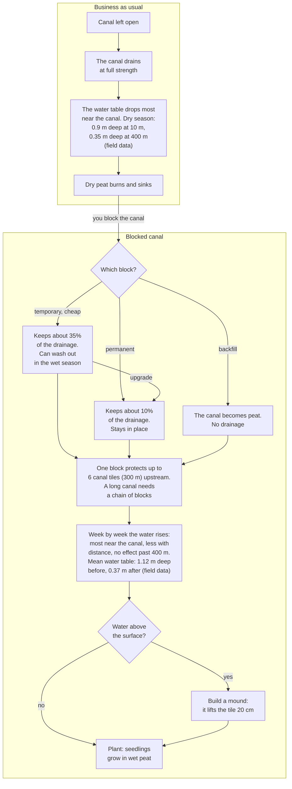

# Canal blocking and the water table

How an open canal drains the peat, how each block type changes that, and how the water rises with distance and time. Plain words for players. Code: `DRAIN` in `src/sim/drainage.js`, `hydroTick()` and `HYDRO` in `src/sim/hydro.js`, `finish()` in `src/sim/game.js`. Boxes marked "field data" come from Ritzema et al. 2014 (`docs/references/peat-hydrology-and-emissions.md`). All other numbers are game values.

Render: [canal-blocking-water.png](canal-blocking-water.png)
