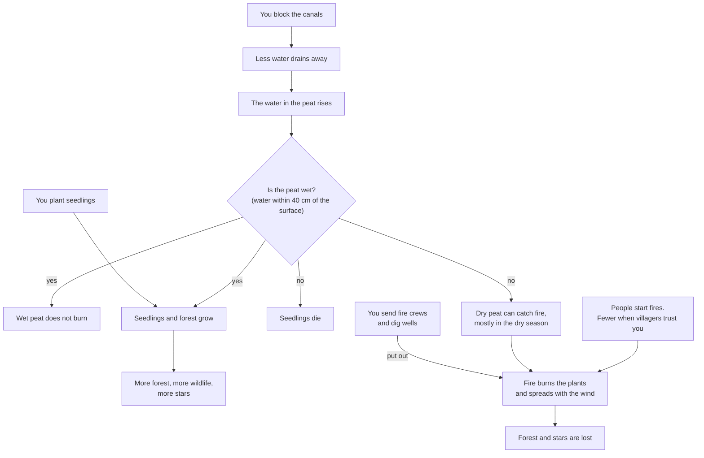

# Water, fire and plant loop

How water, fire and plants affect each other in Rewet, in plain words for players. The code version of this loop is `step()` in `src/sim/game.js`. Related: the gameplay spec `docs/superpowers/specs/2026-11-10-rewet-gameplay-design.md`.

Render: [water-fire-plant-loop.png](water-fire-plant-loop.png)
