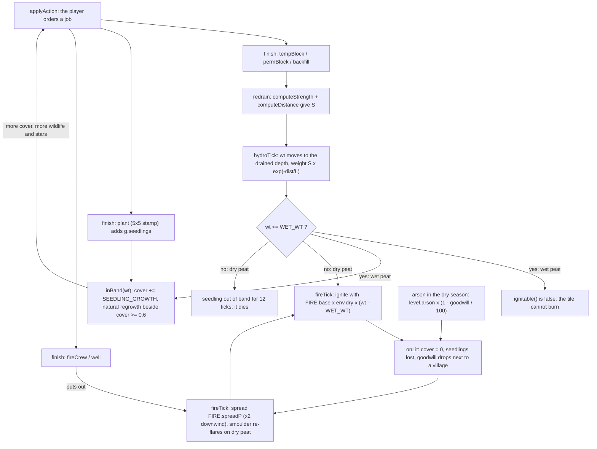

# Water, fire and plant loop

The core gameplay loop of one sim tick: blocks raise the water table, wet peat does not burn, and seedlings grow only on wet peat. Source: `step()` in `src/sim/game.js`, `fireTick()` and `ignitable()` in `src/sim/fire.js`. Constants are named, not copied. Related: the gameplay spec `docs/superpowers/specs/2026-11-10-rewet-gameplay-design.md`.

